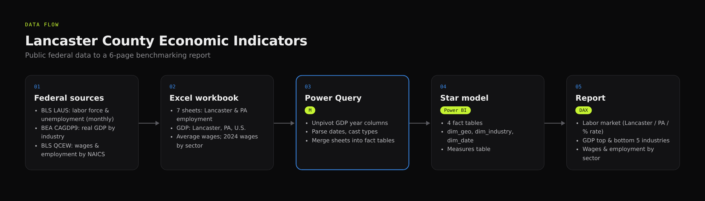
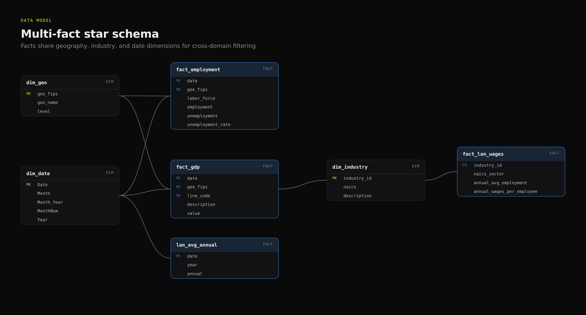
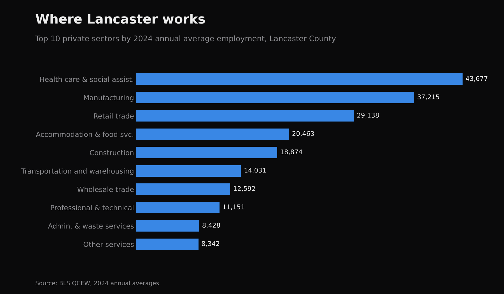
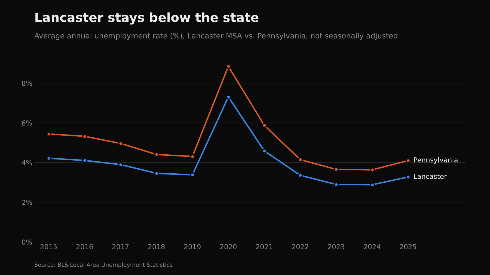
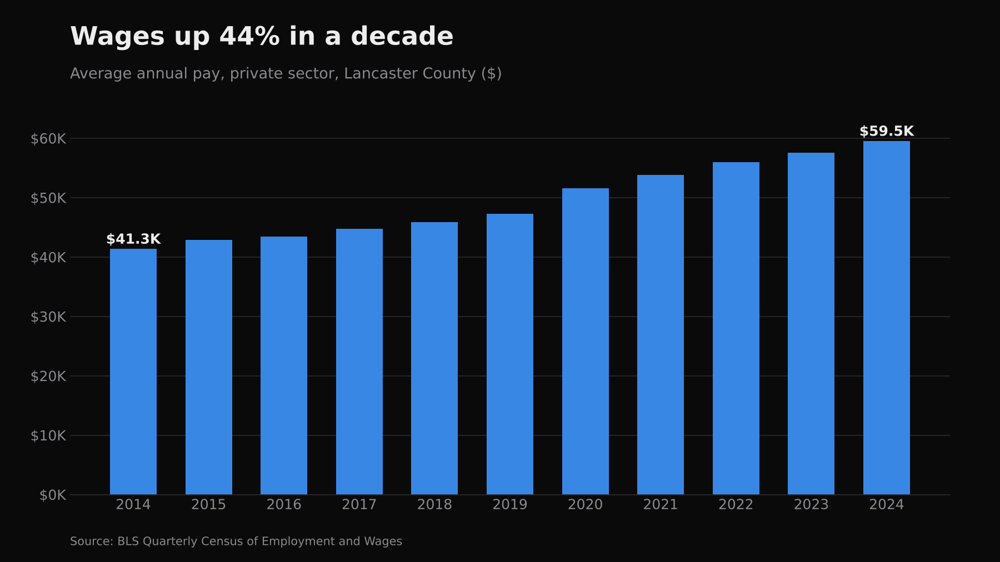

# Lancaster County Economic Indicators Dashboard

An interactive Power BI report that benchmarks Lancaster County, PA against Pennsylvania and the United States on the labor market, real GDP by industry, and wages, using public data from the U.S. Bureau of Labor Statistics (BLS) and the Bureau of Economic Analysis (BEA).

> **Context:** I built this as a technical interview case study for the Center for Regional Analysis at EDC Lancaster County, before joining the team as a Data Analyst Fellow.

## The question
How is Lancaster County's economy performing relative to the state and the nation, and which industries drive its output and wages?

## Data sources
| Source | Dataset | Coverage |
|---|---|---|
| BLS | Local Area Unemployment Statistics (LAUS) | Labor force, employment, unemployment, unemployment rate (2015–2025, monthly) |
| BEA | CAGDP9: Real GDP by county and industry (chained 2017 dollars) | Lancaster, Pennsylvania, U.S. (2001–2024) |
| BLS | Quarterly Census of Employment and Wages (QCEW) | Lancaster average annual private-sector pay (2014–2024) and 2024 wages by NAICS sector |

## Data model
A star-schema variant with several fact tables that share dimensions, so labor, GDP, and wage data can be filtered together:

- **Facts:** `fact_employment`, `fact_gdp`, `fact_lan_wages`, `lan_avg_annual`
- **Dimensions:** `dim_geo` (Lancaster / PA / U.S.), `dim_industry` (NAICS), `dim_date`
- **Measures table:** benchmarking measures such as industry share of total, Lancaster ÷ PA, and Lancaster ÷ U.S.

## Report pages
1. **Labor market:** KPI cards plus annual and monthly labor force and unemployment, with Lancaster / PA / % rate toggles
2. **Rate comparison:** labor-force growth and unemployment rate, Lancaster vs. Pennsylvania
3. **Economic growth:** top and bottom 5 industries by GDP, and the GDP trend for Lancaster vs. PA vs. U.S.
4. **Wages and employment:** average annual wage trend, wages and headcount by sector, and an industry benchmarking table

## Key findings
- Lancaster's unemployment rate ran consistently below Pennsylvania's over 2015–2025, including during the 2020 spike.
- Average annual private-sector pay in Lancaster rose from about $41K (2014) to about $59.5K (2024).
- The largest employers (health care, manufacturing, retail) pay below the county average, while the highest-paying sectors (management, utilities, finance) employ fewer people.

## Repository contents
| File | Description |
|---|---|
| `EDC presentation.pbix` | Power BI Desktop report |
| `Interview Data.xlsx` | Source workbook (7 sheets: Lancaster and PA employment; GDP for Lancaster, PA, and U.S.; Lancaster average annual wages; 2024 wages by NAICS) |

## How to open
1. Install [Power BI Desktop](https://powerbi.microsoft.com/desktop/).
2. Open `EDC presentation.pbix`. If prompted, point the data source to your local copy of `Interview Data.xlsx`.

## Data notes
GDP values are in thousands of chained 2017 dollars. Wage data covers private establishments only. All data remains the property of BLS and BEA.

## Gallery

_Diagrams are editable in draw.io: [`docs/diagrams/`](docs/diagrams)._

**Data flow: federal sources to the Power BI report**

**Multi-fact star schema**

**Employment by sector**

**Unemployment rate: Lancaster vs. Pennsylvania**

**Average annual wages**

<!-- Power BI page screenshots: add as assets/powerbi-page-1-<name>.png, etc. -->
